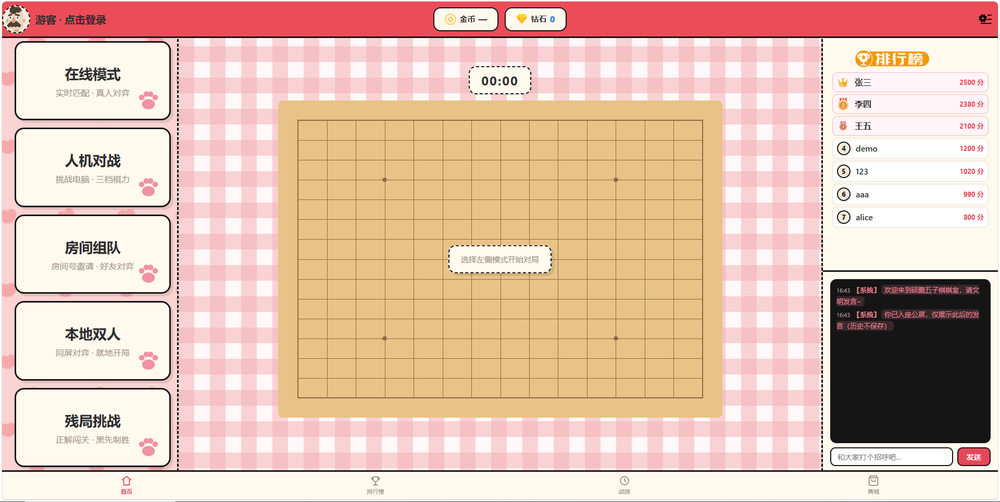

# 五子棋联机对战系统 Gomoku



## ✨ 项目简介
基于 SpringBoot + WebSocket 开发的前后端一体化五子棋联机对战系统。后端负责实时通信、胜负逻辑判定、对局管理、用户数据管理；前端为 H5 静态页面，采用可爱卡通风格UI，支持五种对局模式、积分排行、对局记录、商城皮肤、每日签到、大厅公屏聊天等完整游戏化功能。

## 🎮 功能清单
- ✅ **在线模式**：实时匹配，真人玩家在线对弈
- ✅ **人机对战**：挑战AI电脑，支持三档棋力难度
- ✅ **房间组队**：房间号邀请，好友自建房间对弈
- ✅ **本地双人**：同屏双人，一台设备直接开局
- ✅ **残局挑战**：残局闯关，黑先制胜解谜玩法
- ✅ WebSocket 实时通信，落子状态双向同步
- ✅ 自动判棋：黑白交替落子，横、竖、斜四向五连判定胜负、满盘平局
- ✅ 积分排行榜：对局结算增减积分，全局排名展示
- ✅ 战绩存档：保存历史对局记录，记录对手、时长、胜负
- ✅ 游戏商城：金币解锁、切换多种棋盘皮肤、头像皮肤
- ✅ 每日签到：连续签到领取金币钻石，支持金币补签漏签日期
- ✅ 大厅公屏聊天室：玩家实时文字交流
- ✅ JWT 登录鉴权，用户信息、积分资产、已购皮肤持久化存储到 MySQL

## 🛠 技术栈
- 后端：SpringBoot 3.3.5、WebSocket、MyBatis-Plus、MySQL、JWT、Lombok
- 前端：原生H5 + CSS，静态资源存放于 resources/static
- 构建工具：Maven
- 开发环境：IntelliJ IDEA 2024.1.4，JDK 17

## 🚀 运行步骤
### 环境要求
- JDK 17
- Maven 3.6+
- MySQL 8.0+

### 启动流程
1. 克隆仓库
```bash
git clone https://github.com/anxinyang2027/gomoku-online.git
cd gomoku
